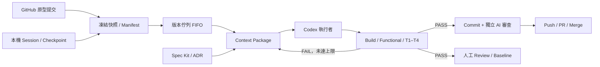

# ProtoFlow

ProtoFlow 是原型驅動的工程引擎：設計者提交 HTML 原型，引擎逐版交給 Codex 實作到正式應用，以建置、功能測試與分層視覺比對驗收，再經獨立 AI 審查後自動提交、開 PR 與合併；也可停在人工 Review。

共享 Node.js 引擎持有流程、協定與驗證；目標專案只接入輕量 Codex Skill、`protoflow.config.json` 與 AGENTS 約定，保留自己的原型、應用與回歸測試，**不複製引擎**。所有證據以 JSON 保存在目標專案的 `.protoflow/`，沒有雲端服務、帳號系統或畫布 UI。

## 目前能力

- **原型來源**：追蹤 GitHub repo／branch／path 的提交，逐筆凍結完整原型快照（固定 SHA 與內容 hash）；未配置 Git 來源時，可改用本機 Design Session／watch／checkpoint。
- **兩種 UI 協定**：schemaVersion 2 以平台中立的**語意錨點**（`data-pf`）描述原型，新增畫面不需改配置；schemaVersion 1 以 selector **元件映射**對應原型與應用。
- **多平台 target**：Web（Playwright）、Electron、iOS（XCUITest）、Android（UiAutomator）、React Native、Expo（Expo Router、CNG）與 Flutter；一份原型可同時驅動多個 target，各自獨立推進。
- **分層驗收**：T1 結構語意、T2 design token（CIEDE2000）、T3 相對版面、T4 視覺（Web 像素、原生 SSIM），每層可設為 required／advisory／off。
- **本機 Runner**：在隔離 worktree 依序呼叫 Codex、驗證與有限次修復；可自動重試暫時性故障、清理殘留程序、持久保存進度，中斷後可安全恢復。
- **自動交付**：通過驗收的版本會被 commit，取得獨立 Codex 審查 PASS 後才推送、開 PR、合併，並且保留 branch protection。
- **政策閘門**：依 L0–L3 分級；L2 需要 Spec Kit 規格，L3 需要人類批准的 ADR。版本必須依序驗收，人工批准綁定當前內容與驗證證據。



## 安裝共享引擎

需要 Node.js 22+、npm、Git 與 Playwright Chromium。原生 target 另需 Xcode、JDK 17、Android SDK 或 Flutter SDK，見 [原生 target](docs/native-targets.md#需求)。引擎尚未發布到 npm，請使用 checkout 或 `npm pack` 產生的本機套件。

```sh
git clone https://github.com/zhangqiu-ai/protoflow.git
cd protoflow
npm ci
npx playwright install chromium
npm run validate
npm link   # 選用：把 protoflow CLI 加到 PATH
```

不想全域安裝時，可以把下文所有 `protoflow` 換成 `node /absolute/path/protoflow/bin/protoflow.js`。

## 接入目標專案

```sh
protoflow init --project /path/to/app
protoflow install --project /path/to/app
```

- `init` 建立 `protoflow.config.json`（schemaVersion 1 的保守預設：沒有映射、adapter 或驗證命令）、prototype 目錄，並在 `AGENTS.md` 加入 managed block。加上 `--repository URL --branch NAME --path DIR [--start-sha SHA]` 會同時寫入 Git 來源與內建 Codex adapter 的路徑。
- `install` 把 Skill 安裝到 `.agents/skills/protoflow/`，接著把 [Spec Kit](https://github.com/github/spec-kit) 與 [BMad Method](https://github.com/bmad-code-org/BMAD-METHOD) 安裝到目標專案，供 L2／L3 使用。安裝命令取自 `adapters.specKit.install`／`adapters.bmad.install`，設為 `null` 表示不安裝。已偵測到的整合會跳過；`--skip-integrations` 只偵測並提醒。安裝前先 commit 或 stash，安裝後檢查 diff，細節見 [整合接口](docs/integrations.md#安裝-spec-kit-與-bmad)。
- 既有配置、Skill 與使用者的 AGENTS 內容都會保留，重複執行會列出 skipped。
- 把 `.protoflow/` 加入目標專案的 `.gitignore`。
- 個人安裝（`install --personal`）見 [Skill 安裝](docs/skill-installation.md)。

## 配置

配置以 JSON Schema 驗證，會拒絕未知欄位、無效門檻和專案外的路徑。

### schemaVersion 2：語意錨點與 targets（新專案建議）

從 [錨點配置模板](templates/protoflow.anchors.config.json) 開始，設計見 [提案 0001](docs/proposals/0001-anchor-contracts.md) 與 [提案 0002](docs/proposals/0002-android-flutter.md)。

```json
{
  "schemaVersion": 2,
  "prototypeDir": "prototype",
  "anchors": {"attribute": "data-pf", "requireScreenAnchor": true, "tokens": "prototype/tokens.json"},
  "targets": [{
    "id": "web",
    "platform": "web",
    "root": "app",
    "driver": {"kind": "playwright-web", "urlTemplate": "app/{page}.html"},
    "build": {"argv": ["npm", "run", "build"]},
    "functional": {"argv": ["npx", "playwright", "test"]},
    "viewport": {"width": 1280, "height": 800, "scale": 1}
  }],
  "policy": {"maxRepairAttempts": 3, "requireHumanReview": true, "sequentialVersions": true}
}
```

- **原型**：每頁一個畫面錨點（`<body data-pf="checkout" data-pf-role="screen">`）；需要追蹤的元素標上 `data-pf="checkout.pay"`。狀態與互動步驟寫在同目錄的 `<page>.pf.json`，tokens 可放在 `prototype/tokens.json`（W3C Design Tokens 格式）。
- **應用**：用該平台原生的測試標記帶上**完全相同的 ID**。

  | 平台 | 標記 |
  |---|---|
  | Web／Electron | `data-testid` |
  | iOS | `accessibilityIdentifier` |
  | Android | `testTag`（搭配 `testTagsAsResourceId`） |
  | React Native | `testID` |
  | Flutter | `Semantics(identifier:)` |

- **驅動器**：`driver.kind` 可以是 `playwright-web`、`playwright-electron`（`main`、`route`）或 `external`。原生平台使用 `external`，透過 [驅動器協定](schemas/driver-request.schema.json) 接入；內建 `scripts/ios-driver.js` 與 `scripts/android-driver.js` 兩個參考驅動器。應用要能以 `PROTOFLOW_SCREEN` 啟動參數直接打開指定畫面；畫面即路由的應用（例如 Expo Router）改用驅動器的 `--launch-url` deep link，見 [原生 target](docs/native-targets.md)。
- **分層與回歸範圍**：Web 預設四層全部 required，並做全量回歸；原生預設 T4 為 advisory，回歸範圍是 `affected+smoke`。checkpoint 以靜態合約比較前後版本，manifest 的 `scope` 列出受影響的畫面與錨點；錨點無效的版本不會產生。target 的 `regression` 可設為 `all`、`affected`、`affected+smoke`；應用尚未涵蓋全部畫面時用 `affected`，避免冒煙測試落在未實作的畫面。
- **共用資源範圍**：頁面引用的共用資源改變時，預設把所有引用的畫面列為受影響。原型以共用 runtime 預先渲染成靜態頁時，可設 `anchors.scopeExclude`（glob，路徑含 `prototypeDir`，如 `prototype/runtime/**`），讓這些資源單獨改變不影響畫面範圍；頁面、sidecar 與合約差異照常計入，因此產生器須把渲染結果（含樣式）反映在頁面本身。
- **動態內容**：`data-pf-text="dynamic"` 標記的錨點只檢查存在，文字不比對，也不從祖先容器文字比對；它的 T2 取樣顏色與水平位置、寬度不比對（內容決定寬度），只比垂直位置與高度；動態內容的高度差會帶動下方錨點，下方錨點在原位或扣掉這個高度差後相符都算通過（固定在底部的按鈕不隨內容移動）。沒有錨點的動態文字（共用介面裡的未讀徽章）可在原型元素上加 `data-pf-text="dynamic"`，或在設定 `anchors.dynamicText` 列出 CSS selector，不必改原型；兩者都從錨點文字中排除。web 與 Electron 目標的原型端和應用端都套用。web 與 Electron 讀取容器文字時，直接在頁面上略過動態錨點，所以和動態文字同字的靜態文字（標題列寫「設定」，側欄標題也是「設定」）會保留；原生目標的應用端只有文字，仍依內容扣除：靜態錨點（包括子錨點全是動態的錨點，例如帶動態日期的列表列）裡與動態文字同字的部分保留，所以搜尋框的值不會把相符列表標題裡的同一個字一起扣掉。原型畫出、真 App 不會出現在畫面文字裡的系統介面（例如原型自己畫的鍵盤）用 `anchors.dynamicText` 列出它的 selector 排除，原生目標的原型端同樣套用。
- **原生比對**：文字比對忽略單獨的分隔符號（`·`、`•`、`—` 等），因為 iOS 合併標籤會省略它們；React Native 攤平後，包住其他文字的具名容器（例如名為「Main navigation」的分頁列）的標籤視為無障礙名稱，不算可見文字。T2 取樣只在兩邊的主色各占元素至少一半時才比對；漸層、開關的軌道與圓鈕沒有穩定主色，不取樣。
- **變體與差異**：同一份程式碼跑在多個平台（React Native、Expo、Flutter）時，用 `variants` 列出 `ios`、`android` 等變體，每個必要變體都 PASS 才接受，交付只做一次。`deviations` 逐錨點宣告已審核的平台慣例差異（`tokens`／`layout`／`visual`）。
- **維護者豁免**（[提案 0005](docs/proposals/0005-maintainer-waivers.md)）：引擎限制短期修不好時，可以申請只涵蓋「一個場景 × 一個 T1–T3 層級（× 一個變體）× 一個原型版本」的豁免，綁定那次驗收的發現全文；需設定 `policy.waivers.reviewers`，由列在其中的人在儀表板核准。被豁免的層級照常比對並保留 FAIL 與發現，只有版本關卡不看它；發現一變、原型改版或撤回就失效。T4 視覺永遠不能豁免。修復代理可在 `.protoflow/engine-limits/` 標示引擎限制，同樣的發現連續失敗時 runner 自動申請（不會自動核准）；`autoApprove` 專案用到豁免的版本仍要人工核准。
- **多目標**：`targets` 可以列出多個平台，各有獨立的 `root`、進度、worktree 與交付分支，一個 target 阻塞不影響其他 target。`release.requireTargets` 讓 `queue` 回報所有必要 target 都已完成的最新版本。多目標時用 `--target <id>` 指定命令作用的 target。
- **工具**：`anchors lint`、`anchors suggest --patch-file`、`contract show`，以及從 v1 遷移的 `migrate anchors`（只產生草稿，不套用）。

### schemaVersion 1：元件映射

每筆 mapping 以 glob 列出原型檔案，並用兩邊頁面的 CSS selector 對應到應用元件；視覺場景寫在 `visual.scenes`。參考 [完整模板](templates/protoflow.config.json)、[原型拆分指南](docs/prototype-structure.md) 與 [配置協定](schemas/config.schema.json)。

```json
{
  "schemaVersion": 1,
  "prototypeDir": "prototype",
  "mappings": [{
    "id": "chat-input",
    "prototypeFiles": ["prototype/chat.html", "prototype/chat.css"],
    "prototype": "#chat-input",
    "application": "[data-ui='chat-input']",
    "component": "src/ChatInput.tsx",
    "priority": "critical"
  }],
  "verification": {"build": {"argv": ["npm", "run", "build"]}, "functional": {"argv": ["npx", "playwright", "test"]}},
  "visual": {"maxDiffRatio": 0.01, "geometryTolerance": 1, "scenes": [{
    "id": "chat.default",
    "prototypeUrl": "http://127.0.0.1:3001/chat.html",
    "applicationUrl": "http://127.0.0.1:3000/chat",
    "viewport": {"width": 1440, "height": 900},
    "mappings": ["chat-input"]
  }]}
}
```

`protoflow mappings suggest` 會掃描原型頁面及其引用的資源，產生 mapping 草稿；`component` 與 selector 留空，由開發者填寫。功能測試與應用擷取也可以透過 [專案驗收 adapter](docs/acceptance-adapters.md)（雙向 JSONL 協定）接入。

## 原型來源與 Runner

### GitHub 提交驅動（正式應用）

配置 `source.kind: "git"` 後，正式應用只由指定 repo／branch／path 的提交觸發，本機的 `watch`／`checkpoint`／`session start` 會被拒絕。完整操作、恢復與限制見 [本機 Runner](docs/git-runner.md)，範本見 [templates/protoflow.git.config.json](templates/protoflow.git.config.json)。

```sh
protoflow doctor --project /path/to/app          # Git、來源、Codex、驗證設定、Chromium、Skill
protoflow source scan --project /path/to/app     # fetch 並凍結新提交
protoflow queue --project /path/to/app
protoflow runner start --project /path/to/app --once   # 省略 --once 則每 15 秒輪詢，Ctrl+C 停止
protoflow runner status --project /path/to/app
```

- **掃描**：沿 branch 的 first-parent 歷史逐筆凍結原型子目錄，包括 HTML、CSS、腳本與二進位素材。只要有外部、可變或無法靜態稽核的資源引用就報錯。快照上限為每檔 2 MiB、總計 20 MiB、1000 個檔案。歷史被改寫（rewind、force push）時記為 `HISTORY_REWRITTEN` 並停止。
- **執行**：應用在 `.protoflow/runner/worktree-*` 的獨立本機分支上實作，不碰主 checkout、index 或 HEAD。每個版本依序執行 Codex → build → functional → 凍結版本的視覺比對，全部 PASS 才前進。
- **重試與失敗**：
  - 供應端的暫時性故障（限流、5xx、串流中斷）會自動重試，次數與間隔由 `policy.transientRetries`、`policy.transientRetryDelayMs` 設定，不計入修復次數。
  - 執行失敗或逾時算一次 attempt，在 `policy.maxRepairAttempts` 內進入下一輪修復，用盡才 BLOCKED。
  - 登入失效或網路完全連不上（DNS、拒絕連線、代理通道失敗）屬於環境問題：立即 BLOCKED，`reasonCode` 為 `environment`，不重試也不計入修復次數。
  - build 因機器而失敗（下載中斷、連線逾時、hermes-engine 退回原始碼建置而缺 cmake）時，等 `policy.transientRetryDelayMs` 後重跑一次；仍失敗則 functional 與視覺比對記為 NOT_RUN，版本 BLOCKED、`reasonCode` 為 `environment`，不進入修復。該 attempt 改過建置輸入（`package.json`、lockfile、`app.json`、Podfile、`ios/`、`android/` 等）時照常修復。
  - functional 因模擬器沒有服務測試而失敗（XCUITest runner 啟動不了：`operation never finished bootstrapping`、`Test crashed with signal … while preparing to run tests`；裝置離線）且輸出沒有任何失敗的測試時，同樣等待後重跑一次；仍失敗則視覺比對不執行，版本 BLOCKED、`reasonCode` 為 `environment`，不論 attempt 改了什麼都不進入修復。
  - 模擬器與 Android 模擬器是整台機器共用的：驗收從第一個用到裝置的命令開始，到驗收結束，獨占命令指名的所有裝置（`--device`、`--avd`、xcodebuild `-destination` 的 `name=`／`id=`、`adb -s`，或命令的 `devices` 欄位）。其他專案或 target 的 Runner 依到達順序排隊等待，事件為 `device-wait`／`device-acquired`，儀表板顯示「等待模擬器（被 <專案>/<target> 使用）」。鎖放在 `~/.protoflow/devices`，以命令寫的名稱或 UDID 為鍵，跨專案請用同一種寫法；持有者的程序結束後鎖自動失效。
  - build 命令可用 `outputs` 列出必須產出的檔案或目錄（相對於執行建置的 worktree 根目錄）；exit 0 但缺少產出，或輸出含 Expo 吞掉的 `pod install` 失敗時，build 記為 FAIL。
  - 一輪修復後的失敗和上一輪完全相同（同樣的失敗項、build 結果、functional 第一個失敗的測試與錯誤、各場景失敗的層級與原因）時，執行代理等於什麼都沒改，一輪就 BLOCKED，`reasonCode` 為 `stalled`；失敗有變但連續 `policy.stallRounds` 輪（預設 2，0 為同時關閉兩種判斷）沒有減少時同樣提前 BLOCKED，不把剩下的修復次數耗在同樣的失敗上。
  - 修復輪的驗收只重跑需要重跑的部分（`policy.repairVerification`，預設 `scoped`，`full` 為每輪完整驗收）：應用沒有改、或只改了測試與文件（`tests/`、`e2e/`、`*.test.*`、`*.spec.*`、`*.md` 等）時，重用上一次驗收 PASS 的 build 與場景（記錄 `reused`、場景 `reusedFrom`），functional 與 hygiene 每輪照常重跑；上一輪失敗的場景先擷取，其中仍有失敗時不再擷取其餘場景（場景 `skipped`、`status: NOT_RUN`，報告記 `partial`）。有 skipped 場景的驗收不會 PASS，不會進入佇列或交付。
  - 驗收只敗在執行代理修不了的設定或原型問題（驅動器擷取尺寸與 target viewport 不符、build 沒產出宣告的 `outputs`、凍結原型到不了該狀態、關閉的層級失敗）時，不耗修復次數，立即 BLOCKED，`reasonCode` 為 `verification-config`，原因依種類列出場景與修法；與真正的失敗混在一起時照常修復，修復請求的 `repair.unrepairable` 告訴執行代理哪些失敗不是它的。
  - 執行者 adapter 以 Context Package 超過輸入上限拒絕時（`Context Package is N characters, above the … input limit`），再送一次也一樣：有 `policy.executor.fallback` 時同一個 attempt 交給備援執行者，否則立即 BLOCKED，`reasonCode` 為 `context-too-large`，由人把版本拆小或改用輸入上限較高的執行者後 retry。
  - 版本因環境、基底移動、Context Package 過大、操作員處理或驗收無法執行而阻塞後 retry，或被獨立審查否決而重開時，原本 `implement` 的方案照用（發出 `plan-reused` 事件），不再呼叫規劃者；`runner retry --answer`、`stalled`／`repair-limit`、`needs-human`、規劃失敗，或 `policy.replanOnReopen: true` 才重新規劃。
  - 只有操作員能修的失敗（例如要改專案 AGENTS.md 保留給人的建置腳本或 `protoflow.config.json`）：執行代理把要改的檔案、內容與原因寫進 Context Package 的 `operatorActions` 檔案，驗收仍 FAIL 時版本立即 BLOCKED，`reasonCode` 為 `operator-action`，原因列出檔案與要改的內容，不再耗用修復次數。執行代理改了 worktree 的 `protoflow.config.json`（例如在 functional argv 加 spec）時，Runner 還原檔案、不交付這個改動；內容有變就不跑驗收，直接以 `operator-action` BLOCKED，原因列出改動的欄位，由操作員修改設定並 `runner configure` 後 retry。`stalled`、`repair-limit` 與 `operator-action` 的原因都附最後一次驗收的編號、失敗項，以及 functional 第一個失敗的測試與錯誤。驗收由 Runner 在執行代理的沙箱外執行；執行代理只因自己的沙箱跑不了測試（綁不了 loopback、啟動不了瀏覽器或 Electron）而要求修改代理 adapter（`protoflow.config.json` 的 `adapters.…`）時，Runner 忽略這項宣告（`operator-action-ignored`），帶著這次驗收結果進入下一輪修復。
  - `runner status` 的 `blocked` 列出卡住版本的 `reasonCode`、開始時間與原始錯誤前幾行；macOS 上版本阻塞或 Issue 需要人決定時發出桌面通知，可用 `notifications.desktop: false` 關閉。
  - 每次執行與驗證後，會終止仍留在 worktree 內的殘留程序。
  - 原型 diff 過大（單檔超過 32 KiB，或整頁產生在同一行）時，送給執行代理的 context 改為指向凍結檔（`frozenBefore`／`frozenAfter`），並附變更處摘錄；`git.diff` 不再和各檔 diff 重複。已凍結的版本直接 `runner retry` 即可套用，不需要重新凍結。見 [大型原型 diff](docs/integrations.md#codex)。
- **恢復**：BLOCKED、STOPPED 或中斷的 RUNNING 必須先查明原因，再執行 `runner retry [--target id]`。設定錯誤時，先用 `runner configure` 明確綁定新設定；改了配置還沒 configure 時，Runner 每輪記錄 `pass-failed` 並列出改了哪些欄位，`runner status` 的 `failing`、心跳與儀表板（連續 3 輪後為 DEGRADED）都看得到，常駐服務不會因此退出。啟動意圖沒有留下 PID 時，用 `runner retry --recover-unknown-start`；引擎會先確認沒有存活程序。規劃者以 `needs-human` 擋下版本時，用 `runner retry --answer "<回答>"`（或面板卡片的「回答並重試」）回答它的問題；回答存在 `retries`，重新規劃時規劃者會讀到；之後 `runner rebase` 或 `runner reclassify` 讓版本從頭重跑，回答仍會保留。原型本身有錯、修正排在後面的版本時，用 `runner supersede` 把卡住的版本併入最新版；舊引擎誤判等級（例如卡在不需要的 `--spec`）時，用 `runner reclassify` 以目前引擎重新分級，見 [重新分級](docs/git-runner.md)。單一 target 的基底在上次交付後被人移動時，Runner 在版本執行前就快轉到新基底；worktree 有基底沒有的工作（修復中的未提交變更，或被獨立審查否決、退回重修版本的提交）而基底沒有改到同樣的檔案時，把工作帶到新基底繼續（`base-aligned` 事件附 `carried`，原內容存在 `refs/protoflow/carried/`）；帶不過去（基底也改了那些檔案，或 worktree 有未被否決的提交）而且沒有已推送或開著 PR 的交付時，Runner 自動做 `runner rebase` 做的事：工作封存到 `refs/protoflow/rebased/`、worktree 重設到目前基底、未交付的版本回到 PENDING 從頭執行，發出 `automated: true` 的 `rebased` 事件並繼續，不等人；`runner.delivery.autoRebase: false` 時改為 BLOCKED（`reasonCode` 為 `base-moved`）等人執行 `runner rebase`。已卡住的交付仍用 `runner rebase` 退回並在目前基底上重跑。`runner gc [--apply]` 會封存並回收不再使用的乾淨 worktree。
- **暫停開發**：`project pause --reason "<原因>"`（或面板專案頁的「暫停開發」）記錄誰、何時、為什麼暫停。暫停期間 Runner 只掃描並凍結新提交，不執行版本、不分流或修復 Issue；常駐服務不退出，前景 `runner start --once` 與 `issues sync` 回傳 `PAUSED`（exit 3）。正在處理的版本會先做完這一輪才停。面板不再顯示「Runner 沒在跑」，改為「已暫停」與「恢復開發」。`project resume` 後從停下的地方繼續：STOPPED 的版本重新排入（同 `runner retry`），BLOCKED 的版本仍等它自己的決定，worktree 不動。見 [暫停開發](docs/git-runner.md#暫停開發)。
- **定期巡查**：可在 Codex app 建立 heartbeat 自動化，定期執行 `runner start --once`、`delivery sync` 與 `delivery status`，見 [定期巡查](docs/git-runner.md#定期巡查codex-自動化)。

### 本機設計流程（未配置 Git 來源）

```sh
protoflow session start --project /path/to/app --label "Adjust chat input"
# 編輯 prototype，或讓 protoflow watch 自動 checkpoint
protoflow checkpoint --project /path/to/app --session SESSION_ID
```

設計命令持有 `.protoflow/design.lock`，應用命令持有 `.protoflow/active.lock`，兩邊可以同時進行。若程序意外退出，必須先確認鎖的 `owner.json` 已不活躍，才能人工恢復。

## 版本佇列

每個 checkpoint 都是一個原型版本，會完整凍結到 `.protoflow/versions/<manifest-id>/`，依建立順序排隊。`context`、`prepare`、`execute`、`verify`、`repair` 只接受佇列的 `current`，也就是最早一個還沒驗收的版本；操作其他版本會回傳 `BLOCKED`（退出碼 3），已驗收的版本也不能重新實作。驗收條件是一份綁定 manifest hash 與原型 hash 的 `PASS` verification。

執行代理與 `verify` 都讀凍結副本，不讀現行原型。應用的 hash 不包含原型目錄與 Git 忽略的未追蹤檔，設計者繼續修改原型不會讓應用端的證據失效。確實不需要依序推進的專案可設定 `policy.sequentialVersions: false`，但代理不得自行關閉。

## 手動推進一個版本

```sh
protoflow context --project /path/to/app --manifest MANIFEST_ID [--spec PATH] [--adr PATH] [--target ID]
protoflow execute --project /path/to/app --context CONTEXT_ID            # 乾跑，先檢查 request
protoflow execute --project /path/to/app --context CONTEXT_ID --execute  # 實際呼叫 Codex adapter
protoflow verify  --project /path/to/app --manifest MANIFEST_ID
protoflow repair  --project /path/to/app --manifest MANIFEST_ID --execute  # 驗證 → 修復 → 再驗證，有次數上限
```

- **分級**：L0 是樣式細節；L1 是局部結構與互動；L2 是資料、API 等功能變更，需 `--spec`（新增或未知的 JavaScript 通常屬 L2）；L3 涉及架構或安全，另需綁定 `manifestHash`、`status: approved` 與真實 reviewer 的 ADR。HTML、Vue、Svelte 以標籤為單位比對，只依真正改動的標籤判斷（整頁擠在一行時，不會因同一行裡未改動的 `storage` 等字眼升級）；樣式、SVG 命名空間、頁內導覽目標（`data-go`、`data-act="go:…"`、本地 `href`）及只重複導覽目標的文字不參與判斷，因此新增畫面不會因導覽列裡的 `home.permission` 被當成 L3，連往其他網域的連結仍算 L2。`--level` 與分類規則只能提高等級。
- **驗證**：固定 viewport、DPR、locale、theme、timezone、fixture、互動步驟與遮罩。任何錨點或映射失敗、未映射的變更、缺少的覆蓋，都不能靠整頁平均值通過。報告輸出到 `.protoflow/artifacts/VER_ID/`，包含截圖、overlay、diff 與逐元件結果。沒有配置或沒有執行的驗證記為 `NOT_RUN`，不算通過。

## 自動交付與獨立 AI 審查

設定 `runner.delivery` 與 `adapters.independentReview` 後，每個 PASS 版本在 Runner 前進前完成交付：

1. 在隔離 worktree commit 應用改動（排除 `.protoflow/`、`node_modules`、建置快取，以及 Git 忽略的生成檔）。
2. 以全新、唯讀、ephemeral 的 Codex session 審查已 commit 的完整應用（`scripts/codex-review-adapter.js`）。審查 session 必須不同於執行者，只有嚴格的結構化 PASS 且沒有 findings 才算通過。
3. `policy.autoApprove: true` 時，才建立 `reviewerKind: automated` 的 Review 與 Baseline。這不能代替真人 ADR 或 GitHub approval。
4. 推送到專用交付分支（多目標時為 `<branch>/<id>`），重用或建立以 `baseBranch`（任何分支，不限 `main`）為目標的 PR，並留言證據。`prBodyTrailers` 讓 PR 正文帶固定標記行（例如 `OpenSpec-Change: <id>`），每個 key 恰好一行，重用的 PR 也會更正，見 [PR 正文附加行](docs/git-runner.md#pr-正文附加行prbodytrailers)。`merge: "auto"` 以 `--match-head-commit` 合併；`"manual"` 留給人合併，可在儀表板或直接在 GitHub 合併；`delivery sync` 與 `runner rebase` 會向 GitHub 查詢並記錄已合併的 PR。不使用 `--admin`，也不強推。

在 `autoApprove` 下，驗收用到維護者豁免的版本不會自動核准：交付停在 BLOCKED（`WAIVER_APPROVAL_REQUIRED`），等人在儀表板核准那份驗收。審查 FAIL 且附 findings 時，Runner 會自動記錄模型拒收並重開版本修復（每版最多 3 次）。因暫時性網路故障而 BLOCKED 的審查會自動重新審查；審查判斷本身永不重擲。GitHub 的只讀請求遇到暫時性錯誤會原地重試（`PROTOFLOW_NETWORK_RETRIES`，預設 2）。

需要人工介入時，用 `delivery sync --retry-review --delivery DLV-… --review AIR-…` 明確取得新的審查；審查 FAIL 時用 `delivery reject-review --delivery DLV-… --review AIR-…` 記錄模型拒收並讓 Runner 重開版本修復。`gh` 必須已登入，且對目標 repo 有寫入權。細節見 [自動交付](docs/git-runner.md#自動交付commit--pr--合併) 與 [獨立 AI review gate](docs/independent-review.md)。

**沒有配置 `runner.delivery` 時，引擎不會 add、commit、push、合併或部署任何東西。**

## 儀表板（提案 0004）

`protoflow dashboard service install` 在本機常駐一個網頁（`http://127.0.0.1:7420/`），一次看所有登記的專案：每頁左側的側邊欄列出所有專案的階段與待你數量，可點選或以 ⌥↑↓ 直接切換、收合成圖示；「等你」收件匣集中所有專案需要你的事，阻塞原因可辨識時附上診斷與修法（例如登入失效時要執行的命令），分頁標題顯示待辦數，也可開啟桌面通知；圓環與管線呈現各 target 的階段，總覽卡片即時顯示進行中的版本、階段與代理最新動作，終端機即時顯示執行代理正在做的事（讀檔、編輯、命令），原型與 App 截圖並排放在仿真機框、可點開大圖並排或疊圖比對，另有角色模型、Issue、交付與事件；淺色／深色與手機寬度皆可用。需要人決定的事可直接在面板核准：合併 `merge: "manual"` 的交付 PR（只合併審查過的 commit）、把 `needs-human` 的 Issue 交回 AI、人工核准版本、把獨立審查否決的版本帶著發現退回重修、重試阻塞的版本、核准／拒絕／撤回維護者豁免（附那次驗收的截圖對照與發現全文；只有列在 `policy.waivers.reviewers` 的人能決定）；附豁免通過的層級以另一個顏色標示，與一般通過分開。每個操作以你的身分執行並留下紀錄。資料來自各專案自己的 `.protoflow/`，不依賴 Claude session。見 [docs/dashboard.md](docs/dashboard.md)。

## Claude 規劃與驗收、GitHub Issues（提案 0003）

角色分開，原型對齊與 GitHub Issues 走同一條鏈：Claude 規劃 → 執行者實作 → 引擎分層驗證 → Claude 驗收 → 交付。

- **規劃者**（`adapters.planner`，`scripts/claude-adapter.js`，建議 `claude-opus-5-5`）：唯讀 session，為每個原型版本產出步驟、逐條驗收條件、需新增的測試與風險；它看得到驗收實際執行的 build 與 functional argv，`test` 條件只能由 functional 會跑的測試證明，需要其他檢查時回 `needs-human` 請操作員加進 functional；L3 版本只有在 `runner.adr` 已由真人核准並綁定該版 `manifestHash` 時才在決策範圍內規劃實作，否則交給人。
- **執行者**（`policy.executor`）：可依工作分流（`routes`）：前端與原型交給 Claude Sonnet（`scripts/claude-exec-adapter.js`，OS 沙箱），後端交給 Codex；任一邊額度不足時，同一個 attempt 改由另一邊重做。未配置時維持 Codex。
- **驗收者**（`adapters.independentReview.provider: "claude"`）：唯讀、全新 session，逐條檢查方案的驗收條件；條件要的檢查 verification 沒跑時回 `NOT_RUN`（配置缺口），不當成產品 FAIL；不得與規劃者或執行者是同一 session。
- **GitHub Issues**（`issues.enabled`）：帶 `protoflow` 標籤（或設 `issues.all: true` 時所有開啟的 Issue，`protoflow:skip` 除外）、作者為 OWNER／MEMBER／COLLABORATOR 的 Issue 由規劃者分流（`planned`、`needs-info`、`needs-human`、`rejected`、`waiting-prototype`，決定以標示為 AI 的留言發布）。規劃者會讀佇列中尚未接受的原型版本；某版已經做了 Issue 要的變更時，Issue 改等那一版，該版接受並交付後自動結案。原型優先：target 閒置且原型都已交付時，`planned` 的 Issue 才在該 target 實作，並重新驗證最新已接受的原型版本，再審查、以 `Fixes #n` 的 PR 合併並結案。在 GitHub 關閉的 Issue 下一次同步記為 `closed` 並離開面板；沒回答就交回的 `needs-human` 只會再分流一次（規劃者改依自己的建議決定），之後要回答或關閉；面板可直接回答、交回或以「不處理，關閉」結案。

所有 Claude 呼叫都只經明確配置的 argv 與 stdin JSON，引擎自行重驗 raw trace。細節見 [integrations](docs/integrations.md#claude-規劃者提案-0003) 與 [提案 0003](docs/proposals/0003-claude-plans-codex-builds.md)。

## 人工 Review 與 Baseline

```sh
protoflow review create --project /path/to/app --manifest MANIFEST_ID --verification VERIFICATION_ID
# 真實的人看過視覺報告並明確批准後：
protoflow review approve --project /path/to/app --review REVIEW_ID --reviewer HUMAN_NAME
protoflow baseline create --project /path/to/app --review REVIEW_ID
```

批准綁定當前內容與驗證證據，內容或驗證一變就失效。PASS 之後若有人或模型拒收（`reject`／`request-changes`；模型拒收需 `--reviewer-kind model --model-evidence FILE`），Runner 下一輪會重開該 target 的同一版本。

## 命令總覽

所有命令都接受 `--project PATH`；以 `protoflow --help` 為準。

| 命令 | 作用 |
|---|---|
| `init` / `install [--personal] [--skip-integrations]` | 建立配置與約定／安裝 Skill、Spec Kit 與 BMad |
| `doctor` | 接入環境診斷 |
| `source scan` / `source status` | 掃描並凍結 Git 提交／來源進度 |
| `runner start [--once]` / `status` / `retry [--recover-unknown-start] [--answer text]` / `supersede` / `reclassify` / `rebase` / `configure` / `gc [--apply]` | 前景 Runner、狀態、恢復、以後續版本取代、以目前引擎重新分級、在移動後的基底上重新開始、綁定新設定、回收 worktree |
| `runner start --service` / `runner service install [--env K=V]` \| `uninstall` \| `status` | 常駐 Runner：macOS launchd 登入即啟動、異常自動重啟、心跳健康檢查（執行中每分鐘心跳；連續失敗時為 DEGRADED，心跳停止 5 分鐘以上為 STALLED） |
| `dashboard add\|remove\|list\|snapshot` / `dashboard serve [--port] [--service]` / `dashboard service install\|uninstall\|status` | 多專案本機儀表板：即時進度、執行代理動作、驗收證據與核准；常駐服務在引擎升版後自動重新啟動（見 [docs/dashboard.md](docs/dashboard.md)） |
| `delivery sync [--retry-review --delivery ID --review ID]` / `delivery status` / `delivery reject-review --delivery ID --review ID` | 自動交付、明確重新審查與操作者觸發的模型拒收；`delivery status` 分開計數通過與附豁免通過的版本 |
| `waiver request --verification ID --scene ID --tier structure\|tokens\|layout [--variant ID] --reason TEXT [--engine-issue URL] --requested-by NAME` / `waiver list` / `waiver show --waiver ID` | 申請維護者豁免（只建立「申請中」，核准只在儀表板）／列出與查看豁免 |
| `project pause [--reason TEXT] [--by NAME]` / `project resume` / `project status` | 暫停開發（Runner 只凍結新提交，不執行版本、不分流或修復 Issue）／恢復開發（被停止的版本重新排入）／暫停狀態；面板也能暫停與恢復 |
| `issues sync` / `issues status` | 分流帶標籤的 GitHub Issue／Issue 狀態（`issues.enabled`；實作由 Runner 進行） |
| `queue` / `status` | 版本佇列（含 `release`）／會話、Baseline、佇列與整合狀態 |
| `anchors lint` / `anchors suggest [--patch-file]` | 檢查錨點與 sidecar／產生錨點建議 patch（v2） |
| `contract show --manifest ID` | 凍結版本的靜態 UI 合約與變更範圍（v2） |
| `migrate anchors [--output DIR]` | v1 映射 → v2 錨點遷移草稿（v1） |
| `mappings suggest` | 由原型頁面產生 mapping 草稿（v1） |
| `session start` / `session list` / `watch [--once]` / `checkpoint` | 本機設計流程 |
| `context` / `prepare --adapter specKit\|bmad` / `execute` / `verify` / `repair` | 手動推進當前版本 |
| `review create\|approve\|reject\|request-changes` | 人工或模型審查決定 |
| `baseline create` / `baseline show` | 保存／讀取批准節點 |

**輸出契約**：stdout 只放結果 JSON（`runner start` 先輸出 JSONL 事件）；失敗時，stderr 最後一行是 JSON 錯誤，之前的行是 `ProtoFlow:` 提醒或診斷。外部命令一律是 argv 陣列，不經 shell 執行。

**退出碼**：`0` 成功；`1` 錯誤或 FAIL；`2` NOT_RUN 或仍需 Review；`3` BLOCKED（包括跨版本操作）。

Node API 從 `src/index.js` 匯出，包括 `requestIndependentReview`、`acceptanceClient` 等可重用接口。

## 範例

| 範例 | 內容 |
|---|---|
| [examples/demo](examples/demo/) | 最小 v1 流程，`npm run demo` 啟動原型與應用 |
| [examples/modular](examples/modular/) | 多頁原型、共用資源與多筆映射（v1） |
| [examples/anchors](examples/anchors/) | 語意錨點、sidecar 狀態與 tokens，一個 Web target（v2） |
| [examples/mobile](examples/mobile/) | 同一份原型驅動 SwiftUI、Compose、React Native、Expo、Flutter 五個 target（v2） |

範例命令請從引擎根目錄執行，例如：

```sh
node bin/protoflow.js anchors lint --project examples/anchors
node bin/protoflow.js checkpoint --project examples/anchors --summary "Tasks v1"
node bin/protoflow.js verify --project examples/anchors --manifest MANIFEST_ID
```

範例的頁面與元件只屬於該範例；試跑只會建立 pending Review，不能代替真實產品的批准。

## 開發與測試

```sh
npm run check       # JavaScript 語法與配置 schema
npm test            # node --test 單元測試
npm run test:e2e    # Node.js Playwright runner
npm run validate    # 以上全部
npm pack            # 產生可移交的本機套件，不會 publish
```

Playwright 有四個 project：`chromium`、`electron`、`ios`、`android`，可用 `npm run test:e2e -- --project=<name>` 分別執行。`ios` 與 `android` 是真實模擬器驗收，需要設定 `PROTOFLOW_IOS_DEVICE` 或 `PROTOFLOW_ANDROID_AVD`；`PROTOFLOW_FLUTTER=1`、`PROTOFLOW_EXPO=1` 另外驗收 Flutter 與 Expo target 的兩個變體。缺少原生環境時，會在報告中明確顯示為 skip，不能當作驗收通過。CI 在 Ubuntu 執行單元測試與 Chromium E2E，在 macOS 執行真實 Electron E2E。

測試都在暫存專案中隔離執行；人工批准測試使用明確標示的 synthetic reviewer。本機 Git fixture 和假的 provider 只是測試替身，真實 GitHub + Codex 驗收另需保留來源 SHA、EXEC JSONL、verification 與截圖，見 [原生 target 驗收紀錄](docs/native-targets.md#驗收紀錄)。

版本號規則見 [AGENTS.md](AGENTS.md)：沒有特別指定時，只遞增第三段。

## 文件

| 文件 | 內容 |
|---|---|
| [docs/architecture.md](docs/architecture.md) | 模組邊界、路由、驗證可信度與限制 |
| [docs/dashboard.md](docs/dashboard.md) | 多專案儀表板：畫面、核准與安全 |
| [docs/git-runner.md](docs/git-runner.md) | Git 來源、Runner、多目標、自動交付與恢復 |
| [docs/independent-review.md](docs/independent-review.md) | 獨立 AI 審查閘門與重用接口 |
| [docs/native-targets.md](docs/native-targets.md) | iOS、Android、React Native、Expo、Flutter 的需求、配置、deep link 啟動與約定 |
| [docs/integrations.md](docs/integrations.md) | Codex、Claude（規劃、執行、驗收）、GitHub Issues、Spec Kit、BMad adapter 與沙箱權限 |
| [docs/acceptance-adapters.md](docs/acceptance-adapters.md) | 專案驗收 adapter 協定（v1） |
| [docs/protocols.md](docs/protocols.md) | 狀態鏈、evidence tree、Manifest、Review、Baseline |
| [docs/prototype-structure.md](docs/prototype-structure.md) | 原型拆分與元件映射（v1） |
| [docs/skill-installation.md](docs/skill-installation.md) | Skill 安裝與個人安裝 |
| [docs/proposals/](docs/proposals/) | 語意錨點（0001）、Android／Flutter／Expo（0002）、Claude 規劃與驗收及 GitHub Issues（0003）、多專案儀表板（0004）、維護者豁免（0005）提案與實作紀錄 |
